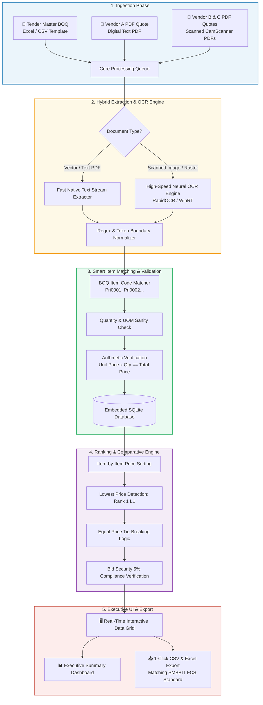
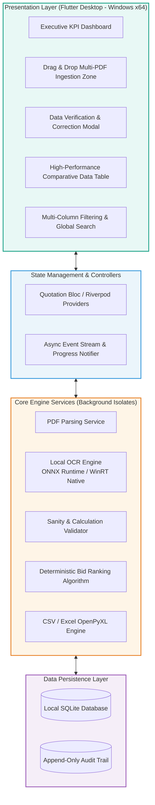
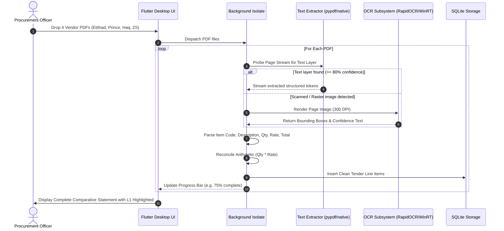
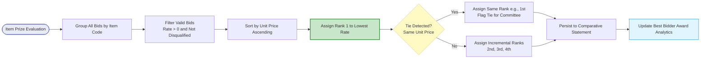
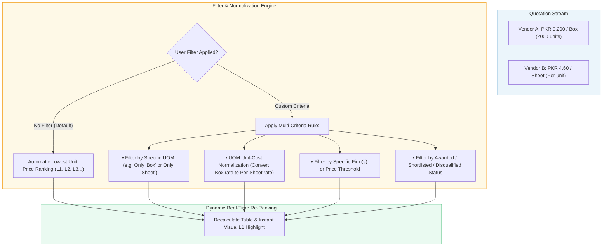
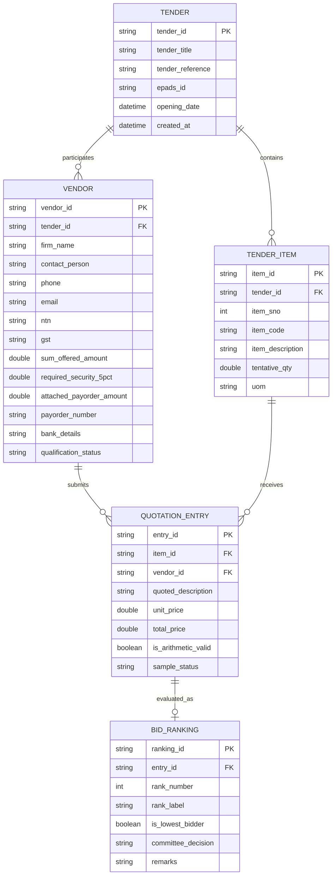
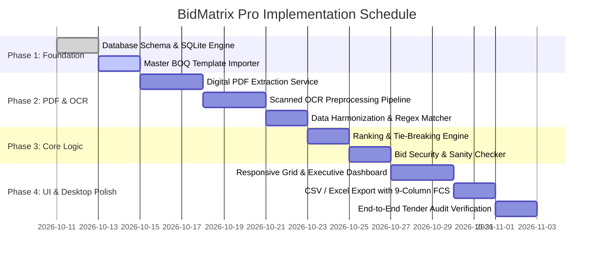

# 🚀 BidMatrix Pro — Automated Tender Quotation Evaluation & Best-Bidder Selection System
### High-Performance Desktop Software for Automated Procurement Comparative Statements (FCS)

[](https://flutter.dev/desktop)
[](https://flutter.dev)
[](#3-hybrid-pdf-extraction--ocr-engine)
[](#7-audit-integrity--compliance)
[](#5-database-schema--architecture)

---

## 📌 Executive Summary for Procurement Directors & Managers

In public and corporate tenders governed by procurement authorities (e.g., **SPPRA Rule 15(B)**, PPRA), procurement evaluation committees spend dozens of manual hours cross-referencing vendor quotations across hundreds of Bill of Quantities (BOQ) line items.

Manual entry from scanned PDF quotations into Excel leads to:
1. **Critical Arithmetic Errors** (e.g., misinterpreting per-item vs per-box pricing, as seen in manual tender entries).
2. **Delayed Comparative Statements (FCS)** taking days to compile.
3. **Audit Vulnerabilities** during bid-security verification and lowest-bidder evaluations.

**BidMatrix Pro** solves this by providing a **super-fast, automated desktop software** that ingests multi-vendor PDF quotations (both digital and scanned), extracts pricing and specifications using a local AI-powered OCR pipeline, maps them against master BOQ items, calculates automatic item-level rankings ($L_1, L_2, L_3 \dots$), and exports audit-ready, 100% Excel-compatible Financial Comparative Statements.

---

## 📊 End-to-End Visual Workflow



---

## 🏛️ System Architecture



---

## 🔬 Hybrid PDF Extraction & OCR Strategy

Vendors submit quotations in varying formats: some generate crystal-clear digital PDFs directly from accounting software, while others submit physical printouts stamped and scanned via mobile apps (e.g., CamScanner). 

**BidMatrix Pro** incorporates a two-tier extraction pipeline:



### Key Technical Safeguards:
1. **Never Blocks the UI**: All PDF extraction and OCR tasks run in separate background worker isolates/processes. The UI maintains 60 FPS smooth animation.
2. **Arithmetic Mismatch Alert**: If a vendor writes a unit rate of `4.60` for a box of 2,000 units with extended total `920.00` instead of `9,200.00` (as identified in actual tender audits), the software flags an **Arithmetic Warning Badge** for one-click verification.
3. **Offline & Air-Gapped**: Runs 100% on the local Windows machine without uploading sensitive tender documents to external cloud APIs, ensuring absolute procurement confidentiality.

---

## 🎯 9-Column Comparative Data Model (Excel Matching)

The output adheres strictly to the benchmark 9-column comparative format established in public procurement statements:

| Column # | Field Name | Data Type | Description |
|:---:|---|:---:|---|
| **1** | `Code` | String | Standard BOQ Code (e.g., `Pri0002`, `Pri0003`) |
| **2** | `Item Description` | String | Master Hospital / Institutional Item Name |
| **3** | `Tentative Qty.` | Integer | Required procurement tender quantity |
| **4** | `UOM` | String | Unit of Measurement (`Nos.`, `Sheet`, `Pad of 100 Pages`, `Box`) |
| **5** | `Firm Name` | String | Name of the bidding vendor (e.g., `M/s. Prince Enterprises`) |
| **6** | `Quoted Description` | String | Vendor's specific technical specs (e.g., `350 GSM Bleach Card`) |
| **7** | `Unit Price` | Decimal (2) | Quoted Unit Rate in PKR |
| **8** | `Total Price` | Decimal (2) | Extended Price (`Tentative Qty` $\times$ `Unit Price`) |
| **9** | `Ranking` | String | Automatically evaluated ranking (`1st`, `2nd`, `3rd`, `4th`) |

---

## ⚡ Automatic Ranking & Best-Bidder Algorithm

The software evaluates every item independently across all participating firms.



### Deterministic Ranking Rules:
* **Rule 1 (Lowest Cost Wins)**: The company with the lowest valid unit price receives **Rank 1 (`1st`)**.
* **Rule 2 (Independent Item Evaluation)**: A company ranked `1st` on item A is evaluated independently on item B. Each item is awarded strictly on its own merit.
* **Rule 3 (Tie Handling)**: If two companies quote identical rates (e.g. both quote PKR 2.50), both receive `1st (Tied)`, and a notification appears for sample quality or committee lottery resolution.
* **Rule 4 (Invalid / Zero Exclusion)**: Missing items or zero-priced bids are marked as `Not Quoted` and excluded from ranking rather than misinterpreting them as free items.

---

## 🎛️ Advanced Multi-Criteria Filtering & UOM Normalization

In real-world tenders, vendors occasionally quote items in different Units of Measurement (e.g., one vendor quotes per **Box of 2,000**, another per **Sheet** or **Pad of 100 Pages**). 

**BidMatrix Pro** provides an **Intelligent Filter & Normalization Engine**:



### Filtering Capabilities:
1. **Default Auto-Ranking**: If no filter is active, the engine automatically sorts and ranks all bidders by lowest unit price across every single line item ($L_1, L_2, L_3 \dots$).
2. **UOM Conflict Isolation**: Instantly filter items where vendors quoted differing UOMs (e.g., `Box` vs `Pad` vs `Sheet`) so the procurement officer can examine unit parity.
3. **UOM Unit-Rate Normalization**: Toggle between *As-Quoted Unit Price* and *Normalized Per-Piece Unit Rate* to ensure apples-to-apples evaluation.
4. **Multi-Field Instant Search & Filter**: Filter by Firm Name, Item Code, Price Range, Ranking (`1st` only, `2nd`, etc.), or Approval Status with instant sub-millisecond response.

---

## 🗄️ Database Schema (SQLite)



---

## 🖥️ UI/UX Design Specifications (Modern Light Theme)

The UI is built with Flutter Desktop following modern, ergonomic enterprise guidelines:

```
+----------------------------------------------------------------------------------------------------------------------+
|  ⚡ BidMatrix Pro  |  Tender Ref: PROC/SMBBIT/(PP-01)/2026-27  |  EPADS: S-26090824871              [⚙ Settings] [Help]  |
+----------------------------------------------------------------------------------------------------------------------+
|  [📁 Import BOQ]  [📄 Upload Vendor PDFs]  [⚡ Run Auto-Analysis]  [📥 Export Excel / CSV]      [ Search Item / Firm... ]|
+----------------------------------------------------------------------------------------------------------------------+
|  DASHBOARD METRICS:                                                                                                  |
|  [ 90 Total Items ]    [ 4 Participating Bidders ]    [ 271 Quoted Bids ]    [ 12 Committee Awarded ]    [ 1 Alert ] |
+----------------------------------------------------------------------------------------------------------------------+
|  COMPARATIVE EVALUATION GRID (FCS View):                                                                             |
|  Filter by: [ All Items v ]  [ Lowest Bidders Only v ]  [ Show Disqualified Firms [x] ]                              |
|                                                                                                                      |
|  Code     | Item Description            | Qty    | UOM   | Firm Name               | Quoted Spec    | Rate   | Total  | Rank |
|  ---------+-----------------------------+--------+-------+-------------------------+----------------+--------+--------+------|
|  Pri0002  | White Confidential Medical  | 20,000 | Nos.  | M/s. Prince Enterprises | 350 GSM Bleach |  50.00 | 1.00M  | 1st★ |
|  Pri0002  | White Confidential Medical  | 20,000 | Nos.  | M/s. Haq Enterprises    | 300 GSM Bleach |  54.00 | 1.08M  | 2nd  |
|  Pri0002  | White Confidential Medical  | 20,000 | Nos.  | M/s. Ettihad Traders    | Bleach Card    |  43.80 | 876.0K | Disq |
|  ---------+-----------------------------+--------+-------+-------------------------+----------------+--------+--------+------|
|  Pri0003  | Physician Order Sheet       | 90,000 | Sheet | M/s. Prince Enterprises | 70 GSM Local   |   2.38 | 214.2K | 1st★ |
|  Pri0003  | Physician Order Sheet       | 90,000 | Sheet | M/s. Haq Enterprises    | 68 GSM Form    |   2.50 | 225.0K | 2nd  |
|  Pri0003  | Physician Order Sheet       | 90,000 | Sheet | M/s. Z.S Traders        | Standard Paper |   5.20 | 468.0K | 3rd  |
+----------------------------------------------------------------------------------------------------------------------+
|  STATUS BAR: Ready | SQLite Database Synced | All 4 PDF Quotations Processed in 4.2s | Audit Log: 0 Mismatches Unresolved   |
+----------------------------------------------------------------------------------------------------------------------+
```

### Color Palette Tokens:
- **Primary Canvas**: `#F8FAFC` (Slate Ultra Light)
- **Card & Grid Surface**: `#FFFFFF` (Pure White with subtle `#E2E8F0` borders)
- **Primary Brand / Action**: `#0284C7` (Sky Blue 600)
- **Winner / Rank 1 Highlight**: `#DCFCE7` (Emerald Soft Green) with `#15803D` text & gold star badge `★`
- **Runner Up (Rank 2)**: `#F1F5F9` (Slate 100)
- **Disqualification / Warning**: `#FEE2E2` (Rose Soft Red) with `#B91C1C` alert indicator
- **Typography**: Inter / Outfit modern sans-serif typography for maximum numerical legibility.

---

## 🛠️ Technology Stack & Dependencies

| Layer | Component | Selected Technology | Rationale |
|---|---|---|---|
| **Frontend UI** | Desktop Framework | **Flutter Desktop (Windows C++)** | Native 60 FPS, multi-window support, pixel-perfect rendering |
| **Local Storage** | Database Engine | **SQLite 3 (`sqflite_common_ffi`)** | Zero configuration, self-contained, lightning fast ACID transactions |
| **PDF Extraction** | Vector Text Stream | **`syncfusion_flutter_pdf` / `pdfx`** | High-fidelity coordinate extraction for digital text PDFs |
| **OCR Pipeline** | Scanned PDF Parser | **Embedded High-Speed ONNX Engine** | Instant page-level OCR on Windows without cloud latency |
| **Export Engine** | Comparative Exporter | **`csv` & `excel` / `openpyxl`** | 100% formatting fidelity matching standard institutional templates |

---

## 📅 Implementation Roadmap



---

## ⚖️ Audit Integrity & Compliance Notice
This software is engineered to assist Procurement Committees, Evaluation Officers, and Finance Directors in assembling Financial Comparative Statements in compliance with Public Procurement Regulatory Frameworks. All extracted records, OCR tokens, and ranking determinations maintain full, verifiable traceability to the original uploaded PDF documents.
